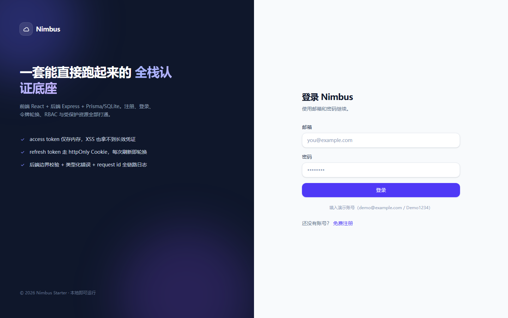

# Nimbus — 全栈认证脚手架

[](https://react.dev)
[](https://expressjs.com)
[](https://www.prisma.io)
[](https://www.typescriptlang.org)

前端 + 后端 + 数据库一体，认证链路完整可跑：注册、登录、令牌轮换、登出、改密、RBAC、受保护资源 CRUD。



## 技术栈

| 层 | 选型 | 说明 |
| --- | --- | --- |
| 前端 | React 19 + Vite + TypeScript + Tailwind v4 | 内存态 token + 401 自动续期 |
| 后端 | Express 4 + TypeScript | Feature-first 分层，严格类型 |
| 数据库 | SQLite + Prisma | 本地零配置，换 Postgres 只改 provider |
| 认证 | JWT(access) + 轮换式 refresh token(Cookie) | 令牌仅存哈希 |

## 快速开始

```bash
npm install          # 安装依赖（前后端 workspace）
npm run setup        # 建表 + 写入种子数据
npm run dev          # 同时启动 API(4000) 与前端(5173)
```

打开 http://localhost:5173 。

演示账号（`npm run setup` 生成）：

| 角色 | 邮箱 | 密码 |
| --- | --- | --- |
| 管理员 | admin@example.com | Admin123! |
| 普通用户 | demo@example.com | Demo1234 |

## 认证设计

- **access token**：JWT，默认 15 分钟，只放前端内存（不进 localStorage），页面刷新靠 Cookie 换新。
- **refresh token**：48 字节随机串，`httpOnly + SameSite=Lax` Cookie 下发，路径限定 `/api/auth`；库中只存 SHA-256 摘要。
- **轮换**：每次刷新立刻吊销旧令牌并换发新的；若命中已吊销令牌，视为重放，该用户所有会话立即失效。
- **改密**：吊销该用户全部会话后再发一个新会话，当前设备保持登录。
- **RBAC**：`role` 字段 + `requireRole()` 中间件，`/api/users` 仅 ADMIN 可访问。

## API

| 方法 | 路径 | 鉴权 | 说明 |
| --- | --- | --- | --- |
| POST | `/api/auth/register` | — | 注册并直接登录 |
| POST | `/api/auth/login` | — | 登录（限流 10 次/15 分钟） |
| POST | `/api/auth/refresh` | Cookie | 轮换刷新令牌 |
| POST | `/api/auth/logout` | Cookie | 吊销当前刷新令牌 |
| GET | `/api/auth/me` | Bearer | 当前用户资料 |
| PATCH | `/api/auth/password` | Bearer | 修改密码（踢掉其它会话） |
| GET | `/api/notes` | Bearer | 当前用户的笔记 |
| POST | `/api/notes` | Bearer | 新建笔记 |
| PATCH | `/api/notes/:id` | Bearer | 更新（仅限本人） |
| DELETE | `/api/notes/:id` | Bearer | 删除（仅限本人） |
| GET | `/api/users` | Bearer + ADMIN | 用户分页列表 |
| GET | `/health` `/ready` | — | 存活 / 就绪探针 |

响应约定：

```jsonc
// 成功
{ "data": { ... } }
// 失败
{ "error": { "code": "VALIDATION_ERROR", "message": "请求参数校验失败", "details": [...], "requestId": "..." } }
```

## 目录结构

```
server/src/
  config/          环境变量集中校验（缺失即 fail fast）
  lib/             prisma、logger、错误类型、令牌、角色
  middleware/      request-id、认证、RBAC、校验、统一错误处理
  modules/
    auth/          schemas / service / controller / router
    users/         DTO + 分页查询
    notes/         归属当前用户的 CRUD
client/src/
  api/             fetch 封装（单飞刷新、错误映射）+ 各模块客户端
  auth/            AuthProvider（冷启动恢复会话）
  components/      UI 原子组件、路由守卫、认证页布局
  pages/           登录 / 注册 / 工作台 / 用户管理
```

## 环境变量

复制 `server/.env.example` 为 `server/.env`，并把 `JWT_ACCESS_SECRET` 换成至少 32 位的随机值。生产环境务必替换：

```bash
node -e "console.log(require('crypto').randomBytes(48).toString('base64url'))"
```

同时把 `CLIENT_ORIGIN` 改成真实域名，并把 Cookie 的 `secure` 依赖 `NODE_ENV=production` 自动开启（要求 HTTPS）。

## 常用命令

```bash
npm run dev          # 前后端并行开发
npm run build        # 后端编译 + 前端打包
npm run typecheck    # 两端类型检查
npm run db:seed      # 重跑种子数据（幂等）
npm run db:studio    # Prisma Studio 看数据
```

## 常见问题

**`npm install` 卡住 / `prisma generate` 长时间无输出**
Prisma 需要从 `binaries.prisma.sh` 下载查询引擎，国内网络容易卡住。改用镜像后重试：

```bash
PRISMA_ENGINES_MIRROR=https://registry.npmmirror.com/-/binary/prisma npx prisma generate
```

若本机开着代理但代理不可用，先把 `HTTP_PROXY/HTTPS_PROXY` 置空再执行。

**端口被占用**
后端改 `server/.env` 的 `PORT`，前端改 `client/vite.config.ts` 的 `server.port` 与代理 `target`。

**接口冒烟测试**
后端跑起来后执行 `bash scripts/smoke.sh`（33 项断言：注册、鉴权、CRUD、令牌轮换、重放检测、RBAC、越权、校验）。

## 换数据库

改 `server/prisma/schema.prisma` 的 `provider` 为 `postgresql`，把 `DATABASE_URL` 换成连接串，`provider` 为 SQL 数据库时可用原生 enum 替换 `role String`，然后 `npm run db:push`。

## 已知限制

- 无邮箱验证与找回密码（需要接邮件服务）。
- 无限流之外的防刷（如验证码、设备指纹）。
- access token 无吊销名单，登出后仍会在剩余有效期（≤15 分钟）内有效 —— 这是无状态 JWT 的固有取舍。
